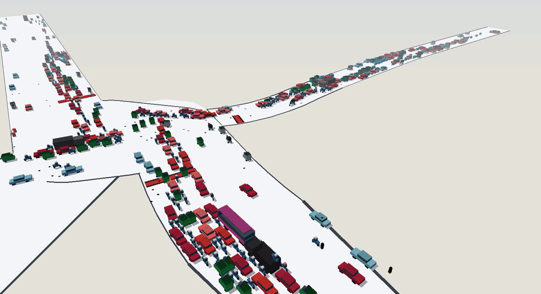
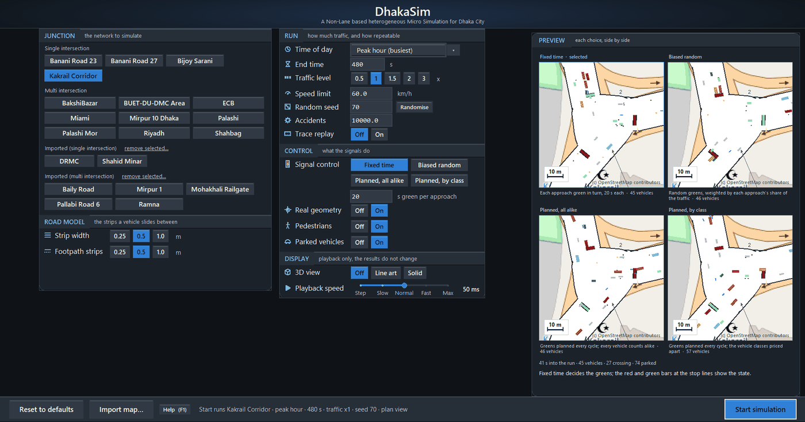
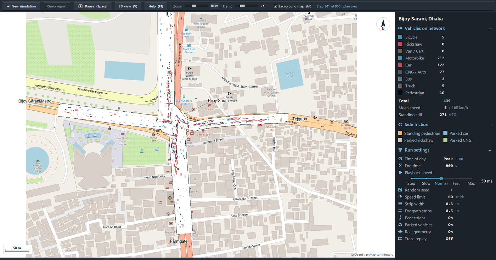
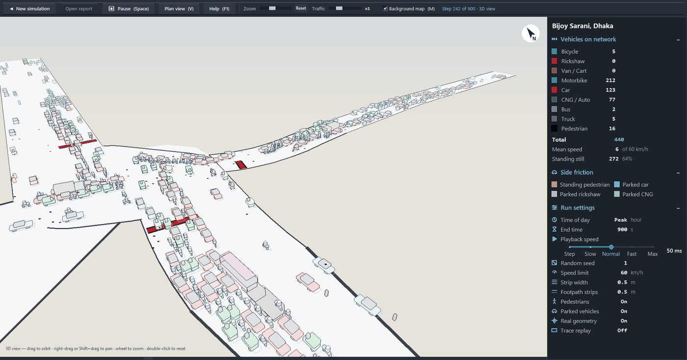
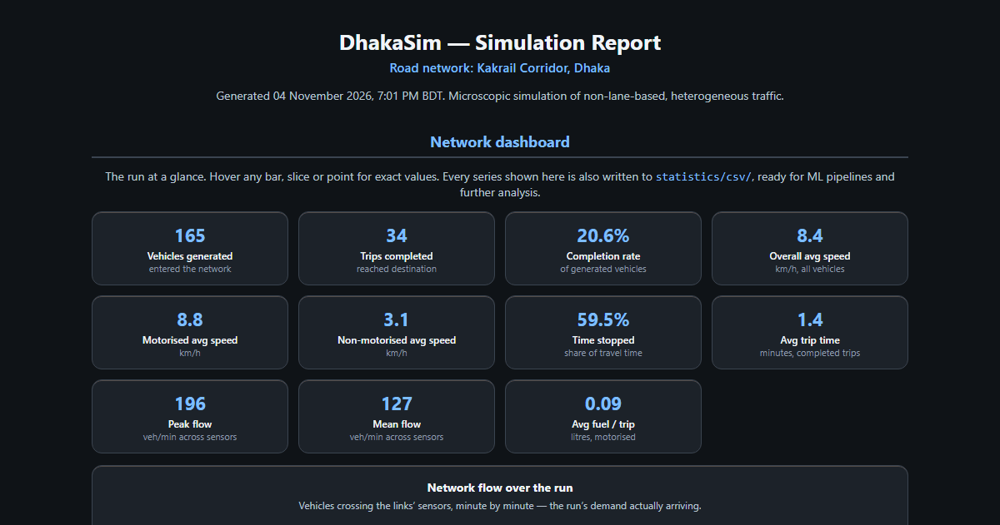
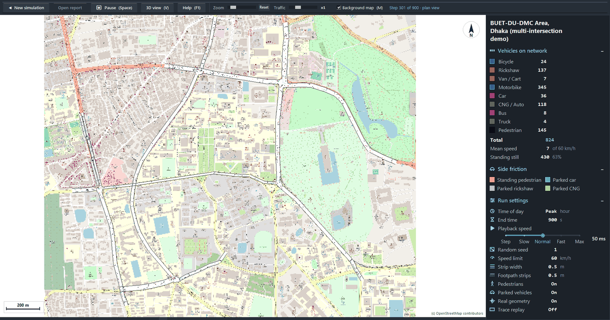

<h1 align="center">DhakaSim</h1>

<p align="center">
  <b>A traffic simulator for roads where nobody keeps to a lane.</b>
</p>

<p align="center">
  
  
  
  
</p>



<p align="center"><sub>Peak hour at Bijoy Sarani, Dhaka. A seeded run, recorded from the app's 3D view.</sub></p>

Buses, rickshaws, CNGs, motorbikes and pedestrians share one road in Dhaka, and lane markings
change little about how they move. DhakaSim models that. You pick a real junction, set the hour and the
traffic level, and watch each vehicle squeeze through in 2D or 3D. Each run then gives you a report
and a folder of CSV files.

## Try It

You need Python 3.10 or newer with `tkinter`. I test on Windows 11.

```bash
git clone https://github.com/Mehzad-Galib/DhakaSIM_python.git
```

```bash
cd DhakaSIM_python
```

```bash
python run_dhakasim.py
```

The settings window opens. Choose a junction and press **Start simulation**. Press **F1** on either
screen for help.

A fresh clone has no street map under the roads, because map images stay out of git. This command
downloads them in about a minute:

```bash
python fetch_basemap.py --all --provider osm
```

To run without a window, pass `--headless`. This run takes seconds and gives the same result each time:

```bash
python run_dhakasim.py --headless --network bijoy_sarani --hour 8 --seed 1 --set SimulationEndTime=120
```

## See It

<table>
  <tr>
    <td width="50%"></td>
    <td width="50%"></td>
  </tr>
  <tr>
    <td><b>Start screen.</b> Point at a setting and the app previews each choice from a real run.</td>
    <td><b>Plan view.</b> Traffic over a street map, with live counts for each vehicle type.</td>
  </tr>
  <tr>
    <td></td>
    <td></td>
  </tr>
  <tr>
    <td><b>3D view.</b> Orbit, pan and zoom mid-run, in solid or line-art style. Press <code>V</code> to switch views.</td>
    <td><b>Run report.</b> One HTML file with a dashboard, tables and animated replays of the run.</td>
  </tr>
</table>

## What It Models

| | |
| --- | --- |
| **Strips, no lanes** | A road is a row of 0.5 m strips. A rickshaw takes a few, a bus takes many, and they all shift sideways into gaps. |
| **13 vehicle types** | Bicycle to truck, each with its own size, speed and behaviour. Surveyed junctions carry their own mix for each hour. |
| **Side friction** | Parked cars, rickshaws and CNGs, standing pedestrians, people walking along the road and people crossing it. |
| **Signals** | Fixed-time, biased random, and two multi-objective planners from [Rahaman et al., 2025](docs/REFERENCE.md#traffic-signal-scheduling). |
| **Real road shapes** | Medians, one-way arms and roundabouts, with links fitted to real streets. |
| **Driver models** | 14 car-following models and 4 lane-changing models. |

## Networks

| Group | Places | Data |
| --- | --- | --- |
| **Surveyed Dhaka junctions** | Banani 23, Banani 27, Bijoy Sarani, Kakrail corridor | Survey counts for all 24 hours |
| **Multi-intersection** | BUET-DU-DMC area, Miami, Riyadh | Roads from OpenStreetMap |
| **Imported Dhaka places** | 13, including Shahbag, Palashi, Mirpur 10 and Ramna | Roads from OpenStreetMap, uniform synthetic demand |

Add your own: press **Import map…** on the start screen and give it a place name or a map link.



## Current Status

*As of 4 November 2026.*

| Area | State | Where it stands |
| --- | --- | --- |
| Traffic model | ✅ Working | All 20 networks finish a run and write a report. I fixed a roadside-object fault on 29 October. |
| Screens | ✅ Working | Start screen, plan view, 3D view, help, keyboard control. |
| Reports and data | ✅ Working | HTML report, CSV files and keyed run records for each run. |
| Signal control | ✅ Working | The `moo-v1` planner beats the best fixed-time plan at 2 of 4 surveyed junctions, measured before the object fix. |
| Tests | 🟡 21 of 22 pass | `test_start_screen` fails one check, for a known reason (problem 3 below). |
| Java parity | 🟡 Partial | Byte-identical with roadside objects off and the parity settings. The object fix departs from Java with objects on. |
| Field calibration | 🔴 Not done | I have no observed travel times, so I cannot check the outputs against real traffic. |

### Open Problems

1. **Roadside objects jam the network.** With objects on, most runs lock up by about minute 3, at any demand. Vehicles stop about 20 m short of an object, which is my main suspect. I have not tested that.
2. **Strip width changes the results.** Wider strips give slower traffic, so fix the width when you compare scenarios.
3. **Imported networks read as shipped ones** on a machine without their gitignored `osm_extract.geojson`. That breaks the start-screen check, and **remove selected…** refuses them.

## Find Your Way Around

| Folder or file | What it holds |
| --- | --- |
| `run_dhakasim.py` | The launcher |
| `dhakasim/` | The simulator (standard library only) |
| `input/` | `parameter.txt` and one folder for each network |
| `statistics/` | Your run reports and CSV files (created when you run) |
| `make_network.py`, `fetch_basemap.py`, `fit_roads.py` | Build a network, fetch its map, fit its links to real roads |
| `experiments/` | Sweep harnesses and the paper-comparison report |
| `tests/` | The test suites, run one file at a time |

**Want more detail?** The [full reference](docs/REFERENCE.md) covers it:

- [Every setting](docs/REFERENCE.md#parameters) and the [input files](docs/REFERENCE.md#input-files)
- [Output files](docs/REFERENCE.md#output-files) and [run records for analysis](docs/REFERENCE.md#run-records-for-analysis)
- [Quirks that will surprise you](docs/REFERENCE.md#behaviour-worth-knowing-about)
- [Signal scheduling](docs/REFERENCE.md#traffic-signal-scheduling) and [what it measures](docs/REFERENCE.md#what-it-measures-on-the-shipped-networks)
- [Importing a map](docs/REFERENCE.md#importing-a-map-from-the-gui) and [fitting links to roads](docs/REFERENCE.md#fitting-the-links-to-the-real-roads)

## Contribute

Run the numeric check first. It fails if the arithmetic has drifted from the Java original:

```bash
python tests/test_javacompat.py
```

The suites do not check the traffic model's numbers, so compare them with a seeded run of each shipped network:

```bash
python hash_run.py
```

Keep the simulator on the standard library. When a change improves the simulator, update the status
table above and retake any screenshot it makes out of date, in the same piece of work. Put the detail in the
[reference](docs/REFERENCE.md).

## Background

DhakaSim began as a Java simulator. This Python port follows it class for class and reproduced its
output byte for byte on matched seeds. [Provenance](docs/REFERENCE.md#provenance) lists where the two now differ.

Read more:

- M. M. Mushfiq et al., ["To Lane or Not to Lane?"](https://ieeexplore.ieee.org/abstract/document/10552416), *IEEE Transactions on Intelligent Transportation Systems*, 2024.
- A. M. S. Rumi et al., ["A Tale of Side Friction Elements in Dhaka City"](https://ieeexplore.ieee.org/abstract/document/10898009), *IEEE Access*, 2025.
- M. Rahaman et al., *Toward Devising A Multi-Objective Traffic Signal Scheduling Approach for Non-Lane-Based Heterogeneous Traffic*, *IEEE Access*, vol. 13, 2025.
